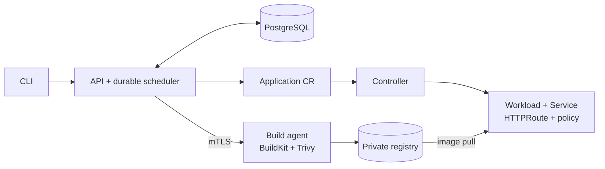

# Local Application Platform (LAP)

LAP is a from-scratch local PaaS engineering project that builds a nine-VM Kubernetes lab and deploys stateless Git applications through its own API, CLI, build agent, and controller.

It demonstrates reproducible infrastructure, secure image delivery, durable deployment decisions, reconciliation, and recovery on one Windows/Hyper-V/WSL workstation. Its scope is a single-host engineering lab; it is not intended to replace a mature production platform.

## Architecture



Terraform creates the Hyper-V lab; Ansible configures the nine Ubuntu VMs; kubeadm bootstraps three control planes and three workers. Helm installs pinned cluster add-ons, and Kustomize installs platform objects. The controller owns application runtime resources.

## Deploy and recover

1. `lap deploy` records an authenticated Operation in PostgreSQL. The scheduler leases it to the build agent, which validates the public HTTPS Git source and `platform.yaml`, builds with rootless BuildKit, scans with Trivy, and publishes an image by digest.
2. The API persists an immutable Release and Deployment intent, then updates the Application CR. The controller reconciles runtime resources. The API accepts the deployment only after two replicas are ready, the route is accepted, and a trusted HTTPS health check succeeds.
3. If a new Release fails runtime health, LAP records the failure and automatically creates a separate deployment of the immediately preceding healthy Release. `lap rollback` can later activate a previously healthy Release without rebuilding from Git.

With API credentials and CA trust configured as described in the [CLI guide](docs/cli.md), set `REPOSITORY_URL` to a public HTTPS Git repository containing `platform.yaml`, and `APPLICATION` to that file's application name:

```sh
uv run --package lap-cli lap deploy "$REPOSITORY_URL" --revision main
uv run --package lap-cli lap history "$APPLICATION"
```

## What is implemented

- Reproducible Hyper-V/WSL Kubernetes lab with HA API access, Cilium networking, MetalLB, Envoy Gateway, cert-manager, and Longhorn.
- Authenticated API and CLI, PostgreSQL-backed leased operations, rootless builds, vulnerability scanning, private registry, immutable Releases, and controller-owned deployments.
- Scoped RBAC and network policies, trusted HTTPS, metrics, logs, traces, dashboards, and alerts.
- Automatic rollback, historical Release activation, and verified PostgreSQL plus registry backup/restore.

## Validation

The live lab has passed end-to-end deploy, build, publish, Release persistence, controller reconciliation, trusted HTTPS health, failed rollout with automatic rollback, historical Release activation, and delete/cleanup. Backup/restore validation includes archive checks, corruption rejection, isolated restore, and production restore resume. The repository also has unit/component, Go, infrastructure, security, and failure checks; live validators report compact PASS/FAIL results with diagnostics on failure.

Run `make test` for the repository regression suite. The full live lifecycle gate is `make v1-acceptance V1_TEST_REPOSITORY=<public-https-fixture-url> V1_TEST_APPLICATION=<unique-fixture-name>`. The fixture must provide healthy `success` and `success-v2` branches and an `unhealthy` branch; see the [demo](docs/demo.md) for a public fixture plan.

GitHub Actions checks pull requests and pushes to `main` with pinned Python, Go, Terraform, and Kubernetes tooling. It runs Python tests and static checks, Go vet and envtest-based controller tests, configuration generation, mocked Terraform tests, Kustomize renders, and a credential-pattern scan of Git publication candidates. CI uses `config/lab.example.yaml` and needs no lab credentials. Live Hyper-V, multi-node Kubernetes, and recovery drills remain local validation gates.

## Read more

- [Three-minute public demo](docs/demo.md)
- [Architecture and design trade-offs](docs/architecture.md)
- [CLI](docs/cli.md), [API and rollback semantics](docs/platform-api.md), and [Application controller](docs/platform-controller.md)
- [Prerequisites and lab setup](docs/prerequisites.md), [image preparation](docs/image-preparation.md), and [networking](docs/networking.md)
- [Backup and restore](docs/backup-restore.md), [failure and security boundaries](docs/failure-security.md), and [observability](docs/observability.md)

## Setup and development

The full lab requires Windows 11 Pro with Hyper-V and WSL2 Ubuntu 24.04. Work from WSL; follow the [prerequisites](docs/prerequisites.md) before provisioning. Copy the portable example to the ignored local configuration and set `hyperv.ssh_public_key_path` for the Windows account running Terraform:

```sh
cp config/lab.example.yaml config/lab.yaml
make config-validate
make config-generate
make help
```

Keep that local configuration for backup verification: an existing archive requires its exact bytes. After rebooting an existing lab, `make lab-start` verifies and repairs WSL routing when needed. Detailed provisioning and operational commands are in the linked documentation and `make help`; generated inputs stay under ignored `.generated/`.

## License

LAP's repository code and documentation are licensed under the Apache License, Version 2.0. See [LICENSE](LICENSE). Third-party dependencies retain their own licenses; see [third-party dependency notes](THIRD_PARTY_NOTICES.md) for source and artifact distribution scope.
